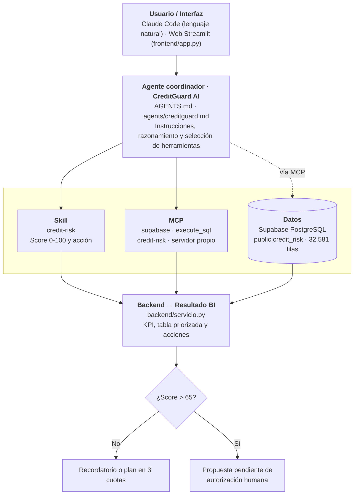

# CreditGuard AI · Credit Risk & Default Intelligence

Sistema agéntico de Business Intelligence que analiza una cartera real de **32.581 préstamos** en Supabase y puntúa su riesgo de impago con una Skill propia. Después propone acciones de cobro; las críticas requieren autorización humana.

## Arquitectura



Todo el acceso a datos es de solo lectura. El agente (vía el MCP propio) y la web llaman al mismo `backend/servicio.py`, por eso dan el mismo resultado. Más detalle en [investigacion/diagrama_flujo_sistema_agentico.md](investigacion/diagrama_flujo_sistema_agentico.md).

## Estructura del repositorio

```text
credit-risk-agent/
├── README.md                          Visión general, instalación y ejecución
├── GUIA.md                            Guía de uso
├── AGENTS.md                          Instrucciones del agente coordinador
├── .env.example                       Variables de entorno (sin valores reales)
├── .mcp.json                          Servidores MCP: supabase (oficial) y credit-risk (propio)
├── investigacion/
│   ├── mercado.md                     Mercado, competidores y oportunidad
│   ├── problema.md                    5 problemas evaluados, usuario, propuesta de valor y KPI
│   ├── diagrama_flujo_sistema_agentico.md
│   └── diseno_de_la_skill.md          Por qué la skill está diseñada así
├── agents/
│   └── creditguard.md                 Agente como subagente de Claude Code
├── skills/
│   └── credit-risk/
│       ├── SKILL.md                   Qué hace, entradas, salida y validación
│       └── credit_risk.py             Fórmula del score
├── data/
│   ├── fuente.md                      Origen, licencia y acceso a los datos
│   └── diccionario_de_datos.md        Columnas, calidad y sesgos
├── backend/
│   ├── db.py                          Acceso a Supabase en solo lectura
│   ├── servicio.py                    Lógica de negocio: consulta, skill, KPI y errores
│   ├── mcp_server.py                  Servidor MCP propio (SDK oficial de MCP)
│   └── test_conexion.py               Prueba de conexión
├── frontend/
│   └── app.py                         Web en Streamlit
├── config/
│   └── settings.py                    Rutas, .env y límites
├── tests/
│   ├── pruebas.md                     9 pruebas obligatorias con evidencias
│   └── test_*.py                      Pruebas automáticas
├── presentacion/
│   ├── CreditGuard_AI.pptx            Diapositivas del proyecto
│   ├── CreditGuard_AI_v2.pptx         Diapositivas con el estilo de la web de resultados
│   └── creditguard_web.html           Web de resultados (publicada en claude.ai)
└── REFLEXION.md                       Reflexión individual y de equipo
```

¿Primera vez? Empieza por la [guía de uso](GUIA.md).

**Web de resultados:** [CreditGuard AI en claude.ai](https://claude.ai/artifact/YBHGjcDRAM12batm5ZcSdG)

## Librerías de GitHub adaptadas
| Librería | Repositorio | Cómo se adapta |
| :--- | :--- | :--- |
| MCP Python SDK | [modelcontextprotocol/python-sdk](https://github.com/modelcontextprotocol/python-sdk) | Construimos con `MCPServer` un servidor propio (`credit-risk`) que expone la skill y el backend como herramientas MCP |
| Streamlit | [streamlit/streamlit](https://github.com/streamlit/streamlit) | Frontend con filtros, KPI y botón de autorización humana; se prueba con su simulador `AppTest` |
| Supabase MCP | [supabase-community/supabase-mcp](https://github.com/supabase-community/supabase-mcp) | Configurado en modo `read_only` y limitado a nuestro proyecto |

## Instalación

1. Python 3.12 o compatible.
2. Instala las dependencias:

   ```powershell
   python -m pip install -r requirements.txt
   ```

3. Copia `.env.example` como `.env` y rellena `DATABASE_URL` (Supabase → Connect → Session pooler). `SUPABASE_URL` y `SUPABASE_KEY` solo los usa la prueba de la Data API. **No subas `.env` a GitHub.**
4. Comprueba la conexión:

   ```powershell
   python backend/test_conexion.py
   ```

## Ejecución

**Frontend web**
```powershell
python -m streamlit run frontend/app.py
```
Se abre en http://localhost:8501. Elige filtros, pulsa **Analizar cartera** y autoriza las propuestas críticas.

**Agente en Claude Code**
1. Abre la carpeta del proyecto en Claude Code (VS Code o terminal).
2. Escribe `/mcp`, aprueba `supabase` (autenticación con GitHub en el navegador) y `credit-risk`.
3. Pregunta, por ejemplo: *"Analiza el riesgo de impago de los 20 préstamos de mayor importe y propón acciones."*

**Backend por terminal**
```powershell
python -m backend.servicio
```

## Pruebas

```powershell
python tests/test_credit_risk.py   # Skill (sin base de datos)
python tests/test_backend.py       # Lógica, errores y validación BI (Supabase)
python tests/test_mcp_server.py    # Servidor MCP propio por stdio
python tests/test_frontend.py      # Frontend con el simulador de Streamlit
```

Resultados y evidencias en [tests/pruebas.md](tests/pruebas.md).

## Notas sobre Supabase
`backend/test_conexion.py` prueba dos vías: PostgreSQL directo (`DATABASE_URL`) y la Data API (`SUPABASE_URL` + `SUPABASE_KEY`). Si aparece `Invalid API key`, sustituye `SUPABASE_KEY` por la clave **Publishable** del mismo proyecto. No uses la contraseña de PostgreSQL como API key ni publiques una clave `service_role`/secret. La tabla tiene RLS activado: si la Data API devuelve 0 filas, revisa sus políticas.
