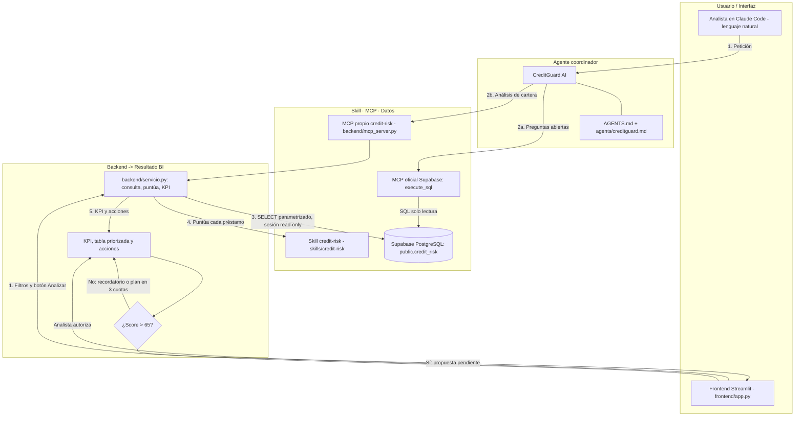

# Diagrama de Flujo del Sistema Agéntico: Credit Risk & Default Intelligence

**Dos puntos de entrada, una sola lógica:** tanto el agente (vía el MCP propio) como el frontend llaman a `backend/servicio.py`, que es el único lugar donde se combinan datos, skill y KPI.
